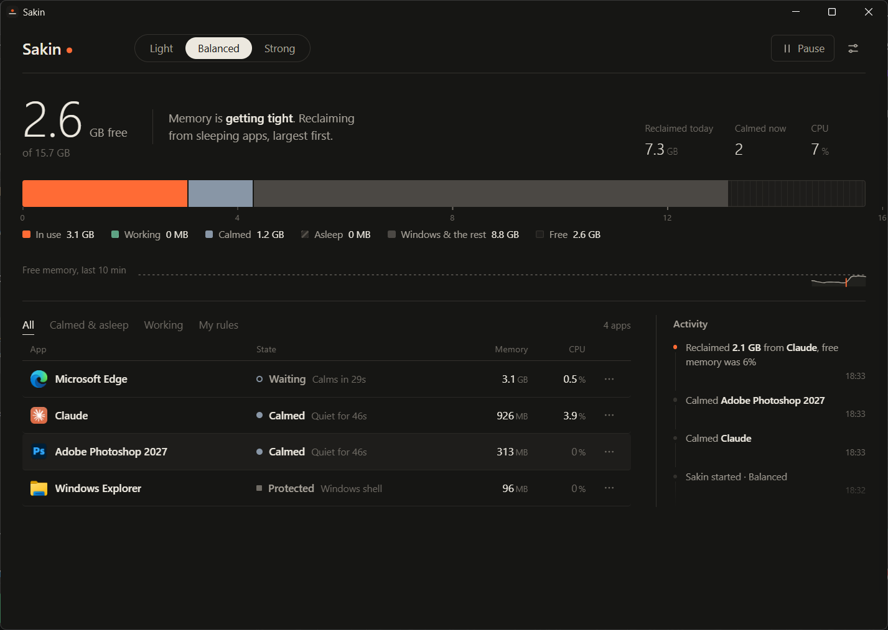
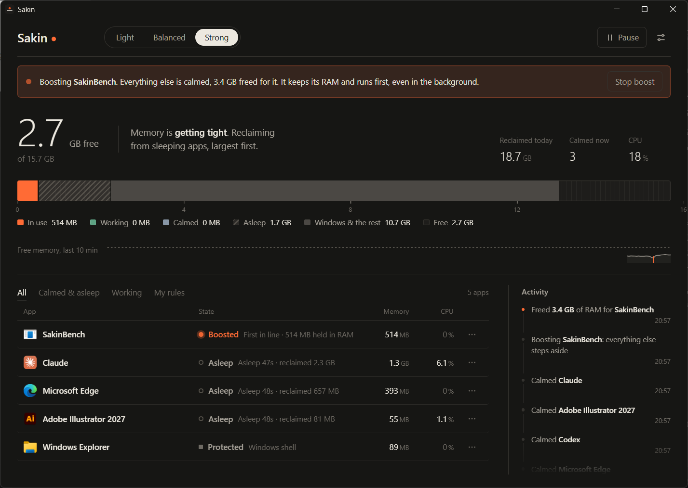

<p align="center"></p>

<h1 align="center">Sakin</h1>

<p align="center">
Give your PC to the app in front of you.<br>
A small, open-source Windows tray app that calms background apps and hands their memory back when RAM runs short.
</p>

<p align="center">
<a href="../../releases/latest">Download</a> ·
<a href="docs/ARCHITECTURE.md">How it works</a> ·
<a href="docs/BENCHMARKS.md">Measurements</a> ·
<a href="README.ar.md">بالعربي</a>
</p>



*Sakin* (ساكن) is Arabic for "still, at rest".

## Why

Leave Photoshop open while you work in a browser and it keeps gigabytes of RAM and a share of the CPU it isn't
using. On a 16 GB machine that pushes Windows into paging, and the app you *are* using stutters.

Sakin watches which app is in front. Apps you've left are calmed: they run in Windows' Efficiency mode on the
efficiency cores, with lower CPU and memory priority. Apps you haven't touched in a while hand their RAM back
when memory gets tight. Switch back to any of them and it's at full speed again within milliseconds.
Anything that's rendering, exporting or playing sound is left alone.

## Measured on a real machine

i7-12700H, 16 GB RAM. Three background apps holding 700 MB each, left unused for 4 minutes,
without Sakin and then with it. Full method and raw numbers in [docs/BENCHMARKS.md](docs/BENCHMARKS.md).

|                                   | Without Sakin  | With Sakin    |
|-----------------------------------|----------------|---------------|
| Average free RAM                  | 1.36 GB        | **2.28 GB**   |
| Free RAM at the end               | 1.57 GB        | **3.13 GB**   |
| Memory held by the idle apps      | 2.27 → 1.05 GB | 2.26 GB → **34 MB** |
| Pages read back from disk         | 16,100 / s     | **8,600 / s** |
| Restoring an app you switch back to | n/a          | **32 ms**     |

The CPU gain is small. Windows already favours the window in front, and Sakin deliberately leaves busy
background apps (renders, exports) at full speed. The real difference is in memory and paging.

## Install

1. Download `Sakin.exe` from the [latest release](../../releases/latest). It's a single self-contained file;
   no .NET install needed.
2. Run it. Sakin installs itself for your user (no admin prompt) to `%LOCALAPPDATA%\Programs\Sakin`, adds itself
   to the Start menu and to *Settings › Apps › Installed apps*, and starts with Windows from then on.
   You can switch that off in Settings. You can delete the downloaded file afterwards.
3. Close the window whenever you like. Sakin keeps working in the tray using about 35 MB.

**Updating:** run a newer `Sakin.exe` the same way; it replaces the installed copy and keeps your settings.
**Uninstalling:** *Settings › Apps › Installed apps › Sakin › Uninstall*. Every app is put back to normal first,
then the program, its startup entry, shortcut and settings are removed.
**Portable:** `Sakin.exe --portable` runs it from wherever it is without installing.

Requires Windows 11 (or Windows 10 21H2+) on x64, plus the Microsoft Edge WebView2 runtime, which ships with Windows 11.

The exe isn't code-signed, so SmartScreen may ask the first time: choose *More info → Run anyway*.
You can also build it yourself (see [Building](#building)).

## What it does to an app

| State       | When | What Sakin does |
|-------------|------|-----------------|
| **In front**  | You're using it | Nothing. Anything Sakin changed is undone the moment it comes to the front. |
| **Working**   | In the background but using CPU or GPU, or playing audio | Nothing, so a render or a call keeps full speed. |
| **Waiting**   | You just left it (30 s by default) | Nothing yet, so quick Alt-Tabs aren't penalised. |
| **Calmed**    | In the background and quiet | Efficiency mode (EcoQoS: efficiency cores, lower clocks), below-normal CPU priority, low memory priority. |
| **Asleep**    | Unused for 10 minutes (default) | Lowest CPU and memory priority. When free RAM drops below 20 %, its working set is handed back to Windows, largest app first. |
| **Protected** | Windows shell, security software, audio, input drivers, or your own rule | Never touched. |
| **Locked**    | Runs as administrator while Sakin doesn't | Can't be touched until you turn on *Full permissions*. |

Sakin only ever **lowers** priority. An app that raised its own (a game, an audio tool) keeps it.
It only trims apps that are actually quiet (under 1 % CPU over the last 30 s); trimming an app that's still
working would just make it pull its memory straight back from disk. Below 8 % free RAM it also trims calmed apps
that have been idle for at least two minutes.

## Intensity

|          | Wait before calming | Asleep after | Reclaim memory below | Treated as working above |
|----------|---------------------|--------------|----------------------|--------------------------|
| Light    | 60 s                | 20 min       | 10 % free            | 8 % CPU / 20 % GPU       |
| Balanced | 30 s                | 10 min       | 20 % free            | 6 % CPU / 15 % GPU       |
| Strong   | 10 s                | 3 min        | 35 % free            | 10 % CPU / 25 % GPU      |

Every number can be changed in Settings. With *Be stricter on battery* on, the wait and asleep times are halved when unplugged.

## Boost: one app gets the machine

When one app matters right now (Illustrator choking on a big file, an export you're waiting for), boost it:

- press **Ctrl+Alt+B** while it's in front (works even when it has stopped responding), or
- right-click the tray icon › **Boost …**, or
- open the app's **⋯** menu in the window › **Boost this app**.

While an app is boosted:

- every other app in the background is calmed at once and its RAM handed back (except apps rendering or playing sound);
- the boosted app's memory is **held in RAM**: Sakin sets a hard minimum working set equal to what it uses, up to
  half your RAM, so Windows can't page it out to make room for something else;
- it runs at above-normal priority and is never throttled, even while you look at another window.

Press the shortcut again, click **Stop boost**, or close the app, and everything goes back exactly as it was.



Measured: with a 5 GB memory flood in the background, a boosted 700 MB app kept 756 MB in RAM and re-read all
its data in 55 ms. Without Boost, Windows paged it out to 10 MB and the same re-read took 372 ms
([details](docs/BENCHMARKS.md#boost-toolsboost-testps1)).

Boost helps when an app is slow because RAM is full. If it's slow because the file is heavy on the CPU or GPU,
the higher priority helps a little, but no tool can add CPU power.

## Claude mode: leave the PC running for Claude

For when you leave the laptop on for hours or days because [Claude Code](https://claude.com/claude-code) is working
on it. Turn it on with the **Claude mode** button at the top of the window or from the tray menu, then walk away.

What runs:

- **Claude itself and everything it starts** (its sessions, MCP servers, builds, `git`, `ffmpeg`, a headless browser)
  runs normally. Sakin follows the process tree from every `claude.exe`, so nothing needs to be listed.
- **Apps Claude is using.** An app wakes up the moment Claude has a live local connection to it (an MCP bridge
  inside Premiere, a local server, a debugging port), or when an app on the *Claude uses this app* list starts
  working (Illustrator or Photoshop driven by script, Chrome through Claude's extension). It stays awake for
  5 minutes after Claude stops using it, then goes back to sleep. Add or remove apps from the list in each app's **⋯** menu.
- **Everything else sleeps at once**: lowest CPU priority, Efficiency mode, low memory priority, and its RAM handed
  back. That includes the window in front when nobody has touched the keyboard or mouse for 2 minutes. Come back
  and the window you use works as always.

What changes on the PC (all put back when you turn Claude mode off, quit Sakin, or uninstall it):

- A power plan of its own: **the PC never sleeps, closing the lid does nothing**, the screen turns off after
  2 minutes, and with *Keep the CPU cool* on (the default) the CPU runs without turbo. Over days that means far
  less heat and fan noise; a long build takes a little longer. Your own plan comes back exactly.
- **Screen off** in the band turns the display off right away.

Sakin can't stop Windows Update from restarting the PC. Pause updates before leaving the PC running for days.

Scripts, and Claude itself, can switch it on the running copy:

```
Sakin.exe --claude-mode on
Sakin.exe --claude-mode off
```

## Per-app rules

Open the **⋯** menu on any app:

- **Automatic**: Sakin decides.
- **Always full speed**: for render and export tools you never want slowed.
- **Always calm it**: calmed in the background even when busy (a browser tab that misbehaves, an updater).
- **Never touch it**.
- **Free its memory now**.

## Safety

- Every change is recorded with the original values in `%LOCALAPPDATA%\Sakin\journal.json`. On quit, on pause,
  and on the next start after a crash, every process is put back exactly as it was.
- Processes started by an app while it was calmed inherit its low priority from Windows. Sakin tracks them and
  gives them normal values when they come to the front.
- Settings live in `%LOCALAPPDATA%\Sakin\settings.json`; the program in `%LOCALAPPDATA%\Programs\Sakin`.
- The window's web view only exists while the window is open.

## Command line

```
Sakin.exe                     open the window (or bring up the running copy)
Sakin.exe --tray              start in the tray only (used at sign-in)
Sakin.exe --quit              quit the running copy and restore every app
Sakin.exe --claude-mode on    switch Claude mode on (or off) in the running copy
Sakin.exe --portable          run without installing
Sakin.exe --uninstall         remove Sakin (add --quiet to skip the prompts)
Sakin.exe --selftest out.txt  check every probe and a calm/restore round trip
```

## Building

Needs the [.NET 11 SDK](https://dotnet.microsoft.com/download).

```
powershell -File build.ps1
```

This produces a single self-contained `Sakin.exe` in the repository root.

The interface is plain HTML, CSS and JavaScript in `src/Sakin/web`. Open `index.html` in any browser to work on
it with mock data (`?lang=ar` for Arabic). Inside the app the page talks to the engine through WebView2 messages.

## Project layout

```
src/Sakin/
  Engine.cs       the policy: grouping processes into apps, states, calming, trimming, the journal
  Probes.cs       process table (one NtQuerySystemInformation call), GPU counters, audio sessions
  Native.cs       Win32 declarations
  TrayApp.cs      tray icon, menu, foreground hook
  MainWindow.cs   WebView2 host and the message bridge
  Startup.cs      start with Windows (Run key, or an elevated scheduled task)
  PowerPlan.cs    Claude mode's power plan, and putting yours back
  TcpProbe.cs     local connections between Claude and the apps it uses
  Installer.cs    per-user install, update and uninstall
  Settings.cs     settings and presets
  SelfTest.cs     --selftest
  web/            the interface (index.html, style.css, app.js, i18n.js, mock.js)
tools/
  ram-test.ps1    A/B memory benchmark
  cpu-test.ps1    foreground speed under background load
  test-switch.ps1 calm-then-switch-back latency
  boost-test.ps1  Boost A/B under a memory flood
  claude-test.ps1 Claude mode end to end: sleep, wake on use, linger, power plan
  bench/          the test apps used by the benchmarks
docs/
  ARCHITECTURE.md
  BENCHMARKS.md
```

## Contributing

Issues and pull requests are welcome. See [CONTRIBUTING.md](CONTRIBUTING.md).

## License

[MIT](LICENSE). The bundled Readex Pro font is under the [SIL Open Font License 1.1](src/Sakin/web/fonts/OFL.txt).
